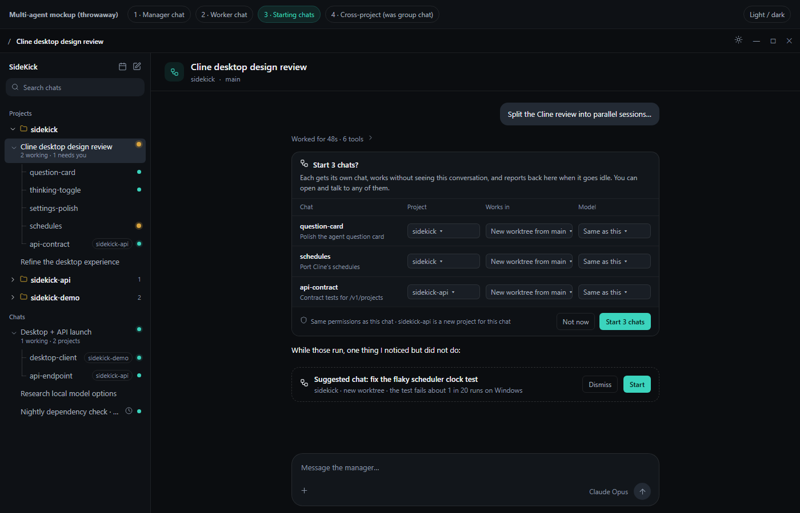
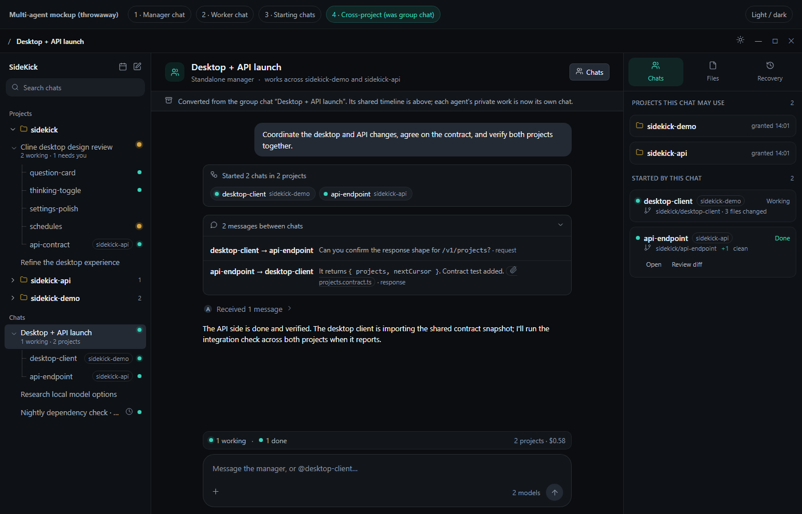

# Multi-agent sessions

Status: accepted, being implemented. Nothing here is shipped yet. Current behavior is described in
[Collaboration](../user-guide/COLLABORATION.md), [Tools](../user-guide/TOOLS.md) and the
[architecture overview](../architecture/OVERVIEW.md).

## Summary

SideKick has three unrelated ways to put more than one agent on a problem: in-run sub-agents, a
two-agent group chat, and conversation forks into managed worktrees. Each has its own storage,
state machine, attention rules and UI. This proposal replaces them with one model:

- Everything durable is a **session** (today's conversation).
- A session can **start other sessions**. The started ones are **worker sessions**: ordinary chats
  with their own transcript, model and usually their own worktree, linked to the session that
  started them, nested under it in the sidebar, and reporting back to it when they go idle.
- Sessions in one **family** (a manager and the workers it started) can **message** each other.
  Messages are untrusted data, never instructions with authority and never approvals.
- **Sub-agents** stay what they are: ephemeral, in-run helpers that return one result. They are
  not sessions and never appear in the sidebar.
- **Group chat goes away.** A multi-project mission becomes a manager session whose workers live
  in different projects. Existing groups are converted.
- Workers never exceed the manager's permissions, and only the user answers approvals.

The rest of this document defines the vocabulary, lifecycle, communication, isolation,
permissions, limits, persistence, migration and UI, then cuts the work into slices that can run as
parallel sessions. [Decisions](#decisions) records what was chosen.

## What exists today

| Feature                     | What it is                                                                                                                                                                                                                                                                       | Main limits                                                                                                                                                                                                               |
| --------------------------- | -------------------------------------------------------------------------------------------------------------------------------------------------------------------------------------------------------------------------------------------------------------------------------- | ------------------------------------------------------------------------------------------------------------------------------------------------------------------------------------------------------------------------- |
| Sub-agents                  | `spawn_subagent` runs a child on `AgentRunKernel` inside the parent's run. It shares the parent's thread, project and permission mode, sees none of the parent's history, gets at most 25 tool rounds, and returns one result. `SubAgentCard` and `SubAgentView` show it inline. | Blocks the parent tool call; depth 1; no resume; interrupted children are lost on restart. Slots are per provider instance (1 to 4).                                                                                      |
| Group chat                  | `CollaborationSupervisor` and `CollaborationStore`: a group with exactly two project-bound participants, a public timeline, private participant sessions, missions, a wake inbox and immutable artifact snapshots, driven by seven `collaboration_*` tools.                      | Hard-coded to two participants; one participant run per project; separate tables, IPC, attention rules and panels; group agents waiting on approval get no sidebar dot, badge or notification; missions pause on restart. |
| Forks and managed worktrees | `conversations:fork` copies a chat, optionally into a new managed worktree (a separate project row). The worktrees session is turning this into first-class worktrees: "Work in" a new worktree, an inventory, sync, safe removal and a folder concurrency guard.                | No link between a fork and its origin beyond `forked_from_*`; nothing reports back.                                                                                                                                       |
| Attention                   | `ConversationAttentionTracker` (main) computes _waiting_; the renderer computes _working_ from mounted chat panels; `unread_completion_at` gives _unread_.                                                                                                                       | _Working_ is only known for chats a panel has mounted, which is wrong for any run started without the user opening it.                                                                                                    |
| Run todos                   | `manage_todo_list` stores a per-run list in `agent_run_todos`.                                                                                                                                                                                                                   | Renders only as a generic tool row; `FocusChain` is never mounted; the list does not survive into the next run.                                                                                                           |

## How other harnesses do it

Checked October 2026 against official documentation and current upstream source.

| Harness                                                             | In-run helper                                                                                                   | Durable peer                                                                                                                                                                                                                                                               | Messaging                                                                                                                                                                                                  | Isolation and permissions                                                                                                                                                             |
| ------------------------------------------------------------------- | --------------------------------------------------------------------------------------------------------------- | -------------------------------------------------------------------------------------------------------------------------------------------------------------------------------------------------------------------------------------------------------------------------- | ---------------------------------------------------------------------------------------------------------------------------------------------------------------------------------------------------------- | ------------------------------------------------------------------------------------------------------------------------------------------------------------------------------------- |
| [Claude Code subagents](https://code.claude.com/docs/en/sub-agents) | Agent tool; own context; final message only; background and resumable by name; nesting up to 3 deep by default. | [Agent teams](https://code.claude.com/docs/en/agent-teams) (experimental): a lead and teammates with a shared task list and per-agent mailboxes; teammates cannot start teammates. Desktop sessions can run in their own worktrees and suggest new sessions as task chips. | [Cross-session messaging](https://code.claude.com/docs/en/cross-session-messaging): `SendMessage` to a named session; incoming messages cannot approve prompts or change configuration; at most 50 queued. | Optional `isolation: worktree` per subagent. Teammates start in the lead's permission mode and their prompts surface in the lead session.                                             |
| [Codex](https://github.com/openai/codex)                            | `spawn_agent`, `send_input`, `wait_agent`, `close_agent`, `resume_agent`; depth 1 and 6 threads by default.     | App chats in managed worktrees; cloud tasks each in their own environment.                                                                                                                                                                                                 | Send with or without triggering a turn; `wait_agent` waits on a mailbox update.                                                                                                                            | Strictest: children inherit the parent's sandbox and approval policy and role files cannot override them. Tool guidance: spawn only when asked, give each agent a disjoint write set. |
| [Cline](https://github.com/cline/cline)                             | `spawn_agent` (shown as `use_subagents`); own context; can edit files.                                          | CLI agent teams: lead-only spawn, shutdown and cleanup; tasks with dependencies; mailbox and broadcast; resumable. Kanban runs each card in its own worktree.                                                                                                              | `team_send_message`, `team_broadcast`, `team_read_mailbox`, `team_await_runs`.                                                                                                                             | Approving the spawn approves everything the subagent does, which is the pattern to avoid.                                                                                             |
| [OpenCode](https://github.com/anomalyco/opencode)                   | Task tool creates a child session with a `parentID`; resumable by `task_id`; depth 1 by default.                | None beyond child sessions.                                                                                                                                                                                                                                                | Result only.                                                                                                                                                                                               | Children inherit the parent's deny rules. The TUI moves between parent and child sessions with leader+Up and leader+Left/Right.                                                       |

What converges and what SideKick takes:

- Two tiers: an ephemeral in-run helper, and a durable session the user can open and talk to.
- Four messaging primitives: start, send, wait (notification-driven, not polling), stop. Results
  flow upward as a final message, not a transcript.
- A fresh context by default, with an explicit opt-in to fork the current conversation.
- A worktree per writing worker. Teams that share a folder document overwrites as their main
  failure.
- Agent messages are never consent. SideKick goes further than Claude Code and OpenCode and adopts
  Codex's rule: a worker's permissions are capped by its starter's.
- Caps on depth, concurrency and queued messages, because runaway spawning and token cost are the
  documented failure modes everywhere.

## The model

### Vocabulary

| Term                    | Meaning                                                                                                                                   |
| ----------------------- | ----------------------------------------------------------------------------------------------------------------------------------------- |
| Session                 | A durable chat: transcript, run ledger, model, project, optional worktree. Today's conversation, unchanged.                               |
| Sub-agent               | An ephemeral helper inside one run of one session. Shares the session's workspace and thread, returns one result, has no chat of its own. |
| Worker session (worker) | A session started by another session. It has its own chat that the user can open and type into.                                           |
| Manager                 | A role, not a type: any session that has started workers. A worker can be a manager only if [depth](#cost-and-concurrency) allows.        |
| Family                  | A manager and every session it started, transitively. The unit for limits, roll-up status, messaging scope and cost.                      |
| Starter                 | Who created a session: the user, another session, or a schedule.                                                                          |
| Handle                  | A short, family-unique name for a worker (`schedules`, `api-contract`), used in messages, chips and the sidebar.                          |
| Brief                   | The first message a worker receives: the task, what done looks like, and any context the manager chose to pass.                           |
| Report                  | The message a worker sends upward when it goes idle: its final answer plus app-collected facts (state, branch, changed files, cost).      |
| Message                 | Anything sent between sessions in a family. Has a sender, recipient, intent and optional attachments.                                     |
| Proposal                | A suggested session the manager did not start; a card the user can start or dismiss.                                                      |
| Attachment              | An immutable text snapshot of a file, sent with a message. Today's collaboration artifact, renamed.                                       |

### What stays, merges and goes

| Today                                                                                              | Decision                                                                                                         |
| -------------------------------------------------------------------------------------------------- | ---------------------------------------------------------------------------------------------------------------- |
| Conversations                                                                                      | **Stay** and become sessions. New columns link them into families.                                               |
| `spawn_subagent`, `SubAgentCard`, `SubAgentView`                                                   | **Stay**, unchanged in behavior. Sub-agents now count against the global run slots, and workers may use them.    |
| Group chat (groups, participants, missions, public timeline)                                       | **Goes.** Replaced by a manager session with workers in several projects.                                        |
| Participant private sessions                                                                       | **Merge** into worker sessions.                                                                                  |
| `collaboration_send`, `collaboration_read`, `collaboration_status`, `collaboration_claim_complete` | **Merge** into `send_message`, the inbox delivered at step boundaries, `list_sessions` and the automatic report. |
| Collaboration artifacts (`share_file`, `list_artifacts`, `import_artifact`)                        | **Merge** into message attachments and `import_attachment`.                                                      |
| Peer message intents (`request`, `response`, `update`, `completion`)                               | **Stay** as message intents, with `completion` replaced by the automatic report.                                 |
| Forks                                                                                              | **Stay** as the user's own action. A fork has no starter link and does not report anywhere.                      |
| Managed worktrees and the folder guard                                                             | **Stay**, owned by the worktrees work. Workers use that API instead of their own.                                |
| Run todos                                                                                          | **Stay**, gain an optional linked session, and render as the task list.                                          |
| Schedules                                                                                          | **Stay**; a scheduled run is a session whose starter is a schedule.                                              |

Rule of thumb for the model, written into the prompt: use a sub-agent for a bounded question or
side task whose result you need in this run; start a session for work the user may want to watch,
steer or review, or that may outlive this run.

### Topologies

One mechanism covers every case; only the project and workspace of each worker differ.

- **Several sessions in one project.** The manager runs in the project folder. Each writing worker
  gets its own managed worktree of that project. Read-only workers may share the folder.
- **Several projects.** The manager may be a standalone chat or a project chat. Each worker runs
  in one project the manager has been [granted](#project-boundaries). Workers in different projects
  exchange information by messages and attachments, never by reading each other's files.
- **Unattended.** A schedule starts a session that may itself start workers, within the schedule's
  stored permissions. Its reports go to the user as notifications and unread dots.

## Lifecycle

### States

Main computes one state per session and publishes it. The renderer no longer infers _working_ from
mounted panels.

| State      | Meaning                                                                         | Dot                                     |
| ---------- | ------------------------------------------------------------------------------- | --------------------------------------- |
| `queued`   | Started, waiting for a run slot.                                                | Dashed ring                             |
| `working`  | A run is active.                                                                | Pulsing accent                          |
| `waiting`  | Blocked on the user: an approval, a question, a plan review, or the wake limit. | Steady amber                            |
| `done`     | Its last run ended normally and the user has not opened it since.               | Solid accent                            |
| `idle`     | Nothing pending and nothing unread.                                             | None, or a hollow ring in session chips |
| `failed`   | Its last run failed or was interrupted.                                         | Red                                     |
| `stopped`  | Stopped by the user or its manager.                                             | Hollow ring, "Stopped" label            |
| `archived` | Hidden from the sidebar; kept with its worktree until cleanup allows removal.   | Not shown                               |

A manager also has a **family roll-up**: the most urgent state among its workers (`waiting` over
`failed` over `working` over `done`). The sidebar shows the manager's own state and, when a worker
needs the user, the amber dot on the manager row too, so a collapsed family never hides a request.

### Create

A session starts a worker with `start_session`. One call may start several, so one approval covers
a batch:

```text
start_session({
  sessions: [{
    title, handle?, brief,
    project?,             // default: the manager's project
    workIn?,              // 'worktree' (default for writers) | 'folder' | 'read-only'
    baseRef?,             // default: the source checkout's HEAD
    model?,               // default: the manager's model
    context?,             // 'fresh' (default) | 'fork'
  }],
  mode?                   // 'start' (default) | 'propose'
})
```

- `start` goes through the permission policy as an `execute`-risk action. In full access the
  sessions start at once and the chat shows a "Started N chats" row. Otherwise the run suspends
  on a durable interaction rendered as the **Start N chats?** card, where the user can change
  each session's project, workspace and model before starting.
- `propose` never starts anything and never suspends. It leaves a proposal card in the chat that
  the user can start later; proposals expire after seven days. This is the path for follow-ups the
  manager noticed but was not asked to do.
- The brief becomes the worker's first message, rendered as "Brief from _manager_", not as a user
  message. `context: 'fork'` copies the manager's transcript up to the call, the way a fork does,
  and is only allowed while the transcript fits the worker model's context budget.
- Main creates the conversation, asks the worktree service for a worktree when `workIn` is
  `worktree` (the worktrees work's `CreateConversationWorktreeInput`), and starts the first run
  itself, without a renderer.

The user can also start a worker by hand: "New chat from here" on a chat creates a linked
worker with the user as author of the brief.

### Run

A worker's run is an ordinary conversation run on `AgentRunKernel` with the conversation surface,
so every existing guarantee (verification, History, recovery, read receipts) applies unchanged. The
differences are in the prompt (its handle, its manager, how to report) and the capability catalog
(see [Permissions](#permissions)).

### Message

`send_message` delivers to one handle, to `manager`, or to `family` (broadcast to every live
session in the family except the sender). See [Communication](#communication).

### Wait

A manager does not poll. It either ends its turn, and main wakes it when reports arrive, or it
calls the existing `wait` tool, which gains one more end condition: a report or message from named
sessions, `any` or `all`. `wait` keeps its time limit and still ends on a user message.

### Report

When a worker's run ends and nothing is queued for it, main sends its report to the manager: the
final assistant message (bounded; the full text stays in the worker's chat) and app-collected facts:
state, branch, commits ahead, uncommitted files, verification status, cost. The worker does not
write a separate summary tool call. A worker that fails or is stopped also reports, with the reason.

The manager is woken with its pending reports when either:

- no worker it started is still `working` or `queued`, so it can reason over all results at once,
  as the Claude Code desktop manager does; or
- a message addressed to it has intent `request` (a worker is blocked on the manager).

`update` messages and status reports such as "waiting for the user" never wake it; they are
delivered at its next step boundary.

### Stop, close, archive and clean up

- `stop_session(handle)` cancels the worker's run and its commands. The manager may stop its own
  workers; workers cannot stop siblings. The user can stop any session.
- Archiving hides a session and its finished family from the sidebar. The model cannot archive;
  it may ask, and the user confirms. "Archive family" on a manager archives every finished worker
  with it.
- Worktree removal belongs to the worktree service and keeps its refusals (running, in use,
  modified, unmerged, not managed). Archiving a worker whose worktree is clean and merged removes
  the worktree; anything else stays in the worktree inventory with the reason.
- "Detach from manager" turns a worker into an ordinary chat: it stops reporting and leaves the
  family. Deleting a manager detaches its workers; it never deletes them.

## Communication

### Messages

- **Addressing.** Handles are unique within a family. A session may message its manager, its own
  workers and its siblings. Nothing outside the family is addressable.
- **Intents.** `request` (expects a reply and wakes an idle recipient), `response` (wakes a
  recipient that is waiting on it), `update` (never wakes), plus app-authored `brief`, `report` and
  `status`. These are the collaboration intents that already avoid acknowledgment loops.
- **Delivery.** Messages are durable rows. A running recipient receives them before its next model
  step, the way collaboration ingests the shared channel today. An idle recipient is woken only by
  the intents above. Each message enters the recipient's transcript with SideKick-authenticated
  sender, handle, project and intent, framed as untrusted content.
- **Authority.** A message cannot approve a permission, answer a question for the user, change a
  setting or grant a project. A worker that a message asks to do something it is not permitted to
  do still asks the user.
- **Broadcast.** `to: 'family'` sends one row per recipient. It never wakes idle sessions, so a
  broadcast cannot start every worker at once.
- **Visibility.** The user can read every message. In the manager's chat, worker-to-worker traffic
  appears as a collapsed "N messages between chats" row; reports and requests to the manager
  appear as a collapsed "Received N messages" row.

### Attachments

`send_message` accepts `attachments: [path]`. Each becomes an immutable UTF-8 snapshot of at most
1 MB from the sender's project, as collaboration artifacts are today. The recipient imports one
with `import_attachment(id, destination)`, which goes through the transactional mutation service,
the permission policy and the no-overwrite rule. Workers in the same repository usually hand work
over through their branches instead, and the manager merges.

### Humans stepping in

- The user can open any worker and type. That message goes to the worker as a normal user message,
  takes precedence over messages from other sessions, and its next report is marked "the user
  stepped in" so the manager does not undo the user's direction.
- The user can message the manager and mention a worker with `@handle`; the manager relays.
- Approvals and questions from a worker appear in the worker's chat, raise the amber dot on the
  worker and its manager, update the manager's task list chip to "Needs you", and produce one OS
  notification naming both. "Go to approval" in the manager's chat jumps to the worker.

### Loop guards

- A manager woken 20 times in a row by sessions, with no user message in between, goes to
  `waiting` with "Paused after 20 automatic turns" and a Continue button.
- At most 50 undelivered messages per recipient; further sends fail with a clear error to the
  sender.
- A request that is not answered before the recipient's run ends is reported back to the sender as
  unanswered, so nobody waits forever.

## Isolation

### Workspaces

| `workIn`    | Use                                                               | Behavior                                                                                                                                               |
| ----------- | ----------------------------------------------------------------- | ------------------------------------------------------------------------------------------------------------------------------------------------------ |
| `worktree`  | Default for any worker that may write.                            | A managed worktree from `baseRef`, on branch `sidekick/<handle>`, through the worktree service.                                                        |
| `folder`    | A worker that must see uncommitted files in the manager's folder. | Same folder as the manager. Subject to the folder guard: a second writer is refused unless sharing is explicitly accepted, and the start card says so. |
| `read-only` | Research, review, triage.                                         | Same folder; the capability catalog drops writes and mutating commands. Not guarded, like research runs.                                               |

The folder guard from the worktrees work applies to every run, including workers and schedules, so
a worker can never silently write into a folder another run is writing in.

### Project boundaries

- A session may start workers in its own project.
- Any other project needs a **project grant** on the manager: the user names the project in a
  message, picks it in the start card, or approves a grant request. Grants are stored per manager
  session, shown in its Chats panel, and revocable.
- A worker receives exactly one project root. It cannot read the manager's project or a sibling's
  worktree unless that is its own project. Cross-project information moves only by messages and
  attachments.
- A standalone manager (no project) can coordinate but has no file tools of its own until it is
  granted a project.

## Permissions

- **Ceiling.** A worker's effective permission mode and capability catalog are capped by its
  starter's at start time, and by the user's global setting at all times. A worker can be
  narrower (read-only, no commands), never broader. A plan-mode manager cannot start workers,
  because plan mode already removes child agents.
- **Grants do not travel.** "Allow for this chat" grants stay in the session where the user gave
  them. A worker asks for its own.
- **Approvals go to the user, with context.** Every approval card in a worker names the worker, its
  manager and its workspace. The manager never sees an approval as something it can answer, and
  the kernel rejects any attempt to resolve an interaction from a tool call.
- **No laundering.** A denial in one session is recorded with the action fingerprint; a sibling
  asked to do the same thing through a message gets the denial context in its approval card.
- **Unattended runs.** A schedule stores the permission ceiling it was created with. A scheduled
  session and its workers wait for the user on anything above that ceiling; nothing is
  auto-approved because nobody is watching.
- **Starting sessions is itself gated.** `start_session` with `mode: 'start'` is an `execute`-risk
  action. `propose` is not gated because it does nothing until the user acts.

## Cost and concurrency

| Limit                   | Default                                                                                                        | Why                                                                                                      |
| ----------------------- | -------------------------------------------------------------------------------------------------------------- | -------------------------------------------------------------------------------------------------------- |
| Global run slots        | 4, configurable 1 to 8                                                                                         | Bounds CPU, provider rate limits and spend. Main queues runs beyond it; queued sessions show `queued`.   |
| Per provider instance   | Generalize today's "Sub-agents at once" into "Runs at once", default 1 for local servers and 4 for hosted ones | A local model server usually serves one request at a time. Sub-agents and sessions share these slots.    |
| Live workers per family | 8                                                                                                              | Matches the current worktree cap; most useful splits are three to five.                                  |
| Depth                   | Workers cannot start sessions                                                                                  | Codex and OpenCode default to depth 1 and Claude Code teams forbid nesting. A setting can raise it to 2. |
| Sub-agent depth         | 1, unchanged                                                                                                   |                                                                                                          |
| Wake loop               | 20 automatic manager turns                                                                                     | See [Loop guards](#loop-guards).                                                                         |
| Queued messages         | 50 per recipient                                                                                               | Matches Claude Code's documented limit.                                                                  |

Each session's usage is already recorded per run. The manager's family strip and Chats panel sum
tokens for the family and cost where the provider reports it (OpenRouter today), and say "cost
unknown" otherwise rather than guessing. An optional family budget (tokens or cost) pauses the
family in `waiting` when reached.

## Persistence and restart recovery

### Data

- `conversations` gains `started_by_conversation_id` (nullable, `ON DELETE SET NULL`),
  `started_by_kind` (`user`, `session`, `schedule`), `handle`, `work_in`, `report_to_conversation_id`
  (null after detach) and `archived_at`.
- `session_messages`: sender, recipient, family root, intent, body, attachments, created, delivered
  to which run, read by the user. Briefs and reports are rows here too, so the chat projection has
  one source.
- `session_attachments`: immutable snapshots, replacing `collaboration_artifacts`.
- `session_project_grants`: manager, project, granted at, revoked at.
- `session_proposals`: proposer, proposed inputs, status (`open`, `started`, `dismissed`,
  `expired`), expiry, started conversation.
- `TodoItem` gains an optional `sessionId`. The manager's latest list carries into its next run, so
  the task list is per session rather than per run.

All tables live in the existing SQLite database and migrate through `SCHEMA_MIGRATIONS`.

### Restart

- Runs that were active become `interrupted` exactly as today; nothing is replayed. Interrupted
  workers show `failed` with "Interrupted by restart" and a Resume action that uses the existing
  run continuation.
- The manager receives one app-authored status message listing what was interrupted, and is not
  woken by it.
- Undelivered messages, proposals, grants and reports are durable and delivered on the next run.
- Pending approvals are cancelled on restart, as today. The worker's chat says which approval was
  lost, so the user can resume and approve again.
- Session states are recomputed from durable rows at startup, so dots are correct before any panel
  mounts.

## UI

The mockups below are throwaway HTML using SideKick's design tokens; they show intent, not final
spacing. They were checked in the light and dark themes. User-facing copy says _chat_;
_session_ is the term in code and in this document.

### Manager session


- **Sidebar.** Workers nest under the session that started them, with a guide line, inside the
  manager's project or the Chats section. A worker in another project shows that project as a
  small tag instead of moving to the other project's group. The manager row shows a one-line
  roll-up ("2 working · 1 needs you"). Families collapse with the manager's chevron.
- **Started row.** "Started N chats" with one chip per worker. Chips carry the live dot and open
  the worker on click.
- **Received row.** Incoming reports and requests collapse into "Received N messages" with sender
  initials; expanded, each line shows the sender, state, a one-line summary and Open or "Go to
  approval".
- **Task list.** The manager's todos render as a pinned card under its latest message. A step
  linked to a worker shows the worker's chip and live state ("question-card · Done", "schedules ·
  Needs you"). The footer counts steps done and steps in other chats.
- **Family strip.** Above the composer: counts by state, family cost, and Stop all.
- **Chats panel.** A new inspector tab beside Files and Recovery: each worker with state,
  title, branch, commits ahead, changed files and actions (Open, Message, Review diff, Stop,
  Archive), plus run-slot and worktree usage.

### Worker session


- **Header.** A breadcrumb back to the manager, the worker's state, and its branch and workspace.
  Actions: Report now (sends a report without ending the work), Stop.
- **Banner.** Who started it, where its reports go, and that the user's messages go to this chat only.
- **Brief card** instead of a user bubble for the first message, and single "Message from …" rows
  for later messages.
- **Approval card** names the worker, its manager and its worktree.
- **Details panel.** The family tree for jumping, plus started-by, workspace, branch status,
  permissions, report target and cost, with Sync with base, Review diff and Detach.

### Starting sessions



The approval card is the `start_session` interaction. A proposal is the dashed card: nothing runs
until the user presses Start.

### Several projects



The former group chat is a standalone manager. Its Chats panel lists the projects it may use;
traffic between workers stays visible as collapsed rows.

### Moving between sessions

- Click any chip, report line or sidebar row.
- The worker's breadcrumb returns to the manager.
- Keyboard: Ctrl+Alt+Up goes to the manager, Ctrl+Alt+Left and Right cycle siblings (OpenCode's
  model), and the command palette gains "Go to chat…" filtered to the current family.
- OS notifications and the tray's waiting list open the worker that needs the user.

Sub-agent UI does not change: `SubAgentCard` inline, `SubAgentView` on drill-in.

## Migration from group chat

1. A migration converts each group into a standalone manager session titled after the group, with
   a project grant for each participant's project.
2. Each participant's private session becomes a worker session in its project, with its handle
   from the participant name and its transcript copied from `collaboration_agent_session_messages`.
3. The public timeline becomes the manager's history: user messages stay user messages, agent and
   peer messages become received-message and between-sessions rows, artifacts become attachments.
4. Active missions are not resumed. Their state is written into the manager as a status message
   ("This group's mission was paused when SideKick was upgraded").
5. The converted manager shows a banner naming the group it came from.
6. A group that cannot be converted (a missing project, an unreadable transcript) is kept read-only
   with an Export action, and the reason is shown.
7. After one release with conversion in place, remove `CollaborationSupervisor`,
   `CollaborationStore`, the collaboration IPC, `GroupChatPanel`, `GroupWorkspacePanel`,
   `GroupSetupDialog`, the Groups sidebar section, the `collaboration` surface and its tables, and
   replace [Collaboration](../user-guide/COLLABORATION.md) with a sessions guide.

Collaboration currently allows one participant run per project. Worktrees and the folder guard
replace that serialization.

## Implementation plan

Each slice is meant to be one session. Slices in the same phase touch different files and can run
in parallel once their phase's prerequisites have merged.

### Phase 1: contracts

- **S0 Contracts and schema.** `src/shared/sessions.ts` (states, handles, message intents,
  start inputs, proposals, grants), the migration, preload API declarations, and
  `browserApiMock.ts` entries with a sample family so renderer slices can work on mock data. Done
  when typecheck passes and the mock preview lists a family.

### Phase 2: in parallel after S0

- **S1 Session lifecycle (main).** A `SessionService` that creates linked conversations, calls the
  worktree service, starts runs without a renderer, stops, archives and detaches. Done when tests
  start a worker in a worktree, stop it and archive it.
- **S2 Messaging and reports (main).** The message store, delivery before model steps, wake rules,
  automatic reports, the `wait` extension and loop guards. Done when tests show a report waking a
  manager only after the last worker goes idle, and a 20-wake loop pausing.
- **S3 Status and attention (main and preload).** One main-owned status service for `queued`,
  `working`, `waiting`, `done`, `failed`, `stopped` and the family roll-up, replacing the renderer's
  busy inference; badge, tray and notifications read it. Done when a run started from main shows
  _working_ with no panel mounted.
- **S4 Sidebar (renderer).** Nesting, dots, roll-up, project tags, collapse, keyboard moves. Merges
  with the schedules session's `renderConversationList` helper.
- **S5 Manager chat (renderer).** Started and received rows, the task list with chips, the family
  strip, the Chats inspector tab.
- **S6 Worker chat (renderer).** Breadcrumb, banner, brief card, message rows, approval context,
  Details panel.

### Phase 3: after S1 and S2

- **S7 Agent tools and permissions.** `start_session`, `send_message`, `list_sessions`,
  `stop_session`, `import_attachment`; catalog entries; the permission ceiling; the start card and
  proposals; prompt guidance.
- **S8 Run slots.** Global and per-provider slots shared by sessions and sub-agents, with a queue;
  generalizes `SubAgentSlots`. Can run beside S7.
- **S9 Project grants.** Storage, the grant request interaction, enforcement in S1's start path,
  and the panel list.

### Phase 4: after S7

- **S10 Group chat migration and removal.**
- **S11 Schedules as starters.** Scheduled sessions use `started_by_kind = 'schedule'`, stored
  ceilings and family limits.
- **S12 Documentation.** A sessions user guide, the architecture overview, Tools and Permissions,
  and removal of this roadmap file.

Merge risks: S4 and the schedules work both change `Sidebar.tsx`; S3 and the tray work both read
attention in `ipc/agentRuns.ts`; S1 depends on the worktrees work's final API.

## Decisions

Accepted October 2026.

1. **Group chat** is retired; existing groups are converted.
2. **Starting sessions** follows the permission mode: sessions start directly in full access;
   otherwise the start card asks first.
3. **Writing workers** default to a new worktree.
4. **Depth:** workers cannot start sessions.
5. **Cross-project workers** nest under their manager with a project tag.
6. **Waking the manager:** reports are batched until no worker is working; requests addressed to
   the manager wake it at once.
7. **Restart:** interrupted workers are shown with Resume; nothing resumes automatically.
8. **Limits:** 4 global run slots, 8 live workers per family, 20 automatic manager turns.
9. **UI noun:** the UI keeps saying "chat"; "session" is used only in code.
10. **Sub-agents** stay unchanged.

## Risks and open questions

- Token cost multiplies with every worker. The family strip and budgets make it visible, but a
  model that starts sessions too eagerly is the main risk; the prompt follows Codex's guidance to
  start sessions only when asked or clearly beneficial, and proposals are the default for
  unrequested work.
- Merging workers' branches is left to the manager or the user. A later slice could add a "Merge
  into base" action on a done worker using the worktree service's sync.
- Run todos are per run today; carrying the manager's list across runs changes how
  `manage_todo_list` is stored and must not break existing chats.
- `context: 'fork'` needs a size check against the worker model's context window.
- The worktree cap (8 today) and the per-family worker cap must stay consistent with whatever the
  worktrees work settles on.
